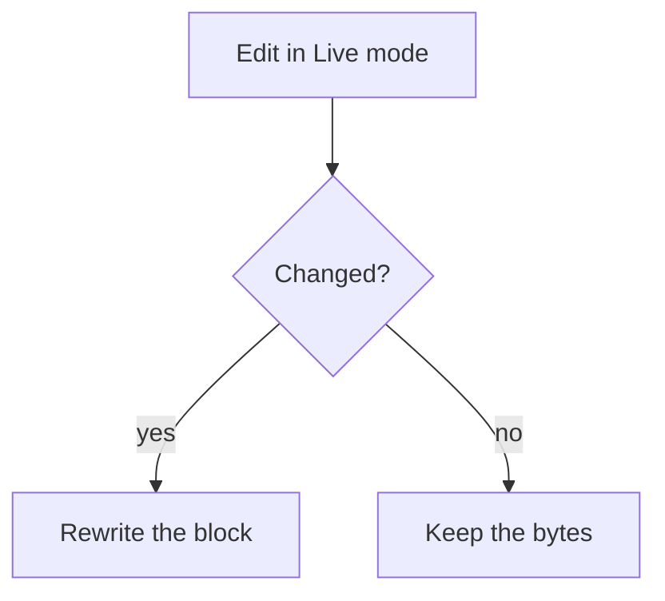

# Marklive showcase

This document exercises the features of **Marklive**: *emphasis*, __strong with underscores__, ~~strikethrough~~, `inline code`, [links](https://example.com "Example") and <https://autolinks.example>.

Setext heading
--------------

## Lists

- First item
- Second item with **bold**
  - Nested item
  - Another nested item
* A different bullet starts a new list

1. One
2. Two
3) Parenthesis delimiter starts a new list

### Tasks

- [ ] Write the spec
- [x] Build the parser
- [ ] Ship the extension

## Quote

> Markdown is intended to be as easy-to-read and easy-to-write as is feasible.
>
> > Nested quote with `code`.

## Code

```ts {linenos=true}
export function greet(name: string): string {
  return `Hello, ${name}!`;
}
```

~~~python
def fib(n):
    return n if n < 2 else fib(n - 1) + fib(n - 2)
~~~

    indented code block
    stays indented

## Mermaid



## Table

| Feature | Status | Notes |
|:--------|:------:|------:|
| Round trip | ✅ | byte for byte |
| Tables | ✅ | GFM |
| Escaped \| pipe | ✅ | `a\|b` |

## Raw constructs

<details>
<summary>HTML block</summary>

Kept verbatim.

</details>

A footnote reference[^note], a [[Wiki Link|wikilink]], inline math $e^{i\pi} + 1 = 0$ and a [reference link][ref].

$$
\int_0^1 x^2 \, dx = \frac{1}{3}
$$

[^note]: Footnote definitions are preserved.

[ref]: https://example.com/reference "Reference"

---

Hard break with two spaces  
and with a backslash\
end.


